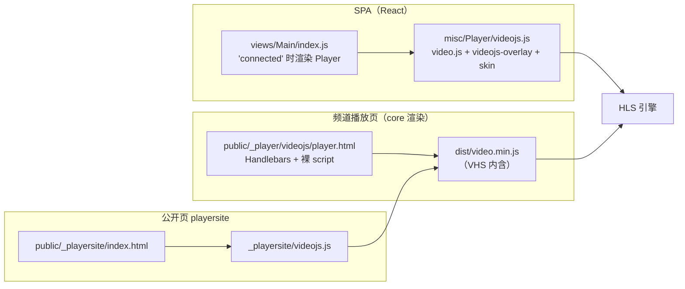
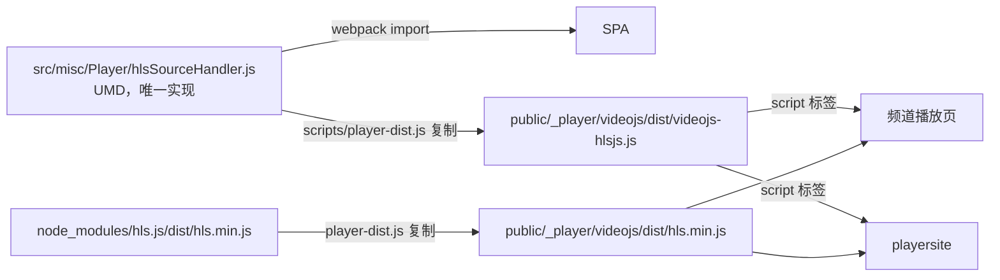

# AV1 预览播放审计（Forgejo issue #21）

本文件是 issue `restreamer-ui-arc#21` 的永久审计记录：原始报告里哪些成立、哪些不成立、缺陷到底在哪一层、
为什么这样修、修完能证到哪一步、部署与回滚怎么做、以及哪些结论目前**不能**声称。

配套证据在 [`docs/evidence/preview-20261104/`](./evidence/preview-20261104/)。
复现命令见 [§9](#9-复现命令)。

关联：

- 问题单：<https://forgejo.vtopia.top/SKPloft/restreamer-ui-arc/issues/21>
- UI：`fix/21-av1-preview`（本仓）
- core：issue `SKPloft/core-arc#1` → PR `SKPloft/core-arc#2`，squash 合并后 `origin/main = e081ec07ae589609ad3188c07bac124379fbfa56`
- 部署/现场验收：<https://forgejo.vtopia.top/SKPloft/devops/issues/40>
- 流程：按 `promptfoo-config/CONTRIBUTING.md`（编号分支 / Conventional commit + `Refs` / PR + `Closes` / squash 自合），不新增 CI 门禁

---

## 0. 结论

1. **现象真实**：AV1 频道的预览在黑屏/报错，`video.js` 最终给 `CODE 3`（`No available working or supported playlists`）。
2. **原 issue 的根因叙述有四处不成立**（详见 [§2](#2-原始-issue-断言核实)）：
   VHS 并不“不探测 fMP4 init”；`avc1` fallback 不是统一解释；“MPEG-TS 无法承载 HEVC”在 FFmpeg 封装层不成立；
   `master_playlist=true` 不是可靠解法。
3. **精确根因**：`@videojs/http-streaming` 3.13.3 的 fMP4 探测把非 H.264 视频只报成**裸 4CC**（`av01`/`vp09`/`hvc1`），
   裸 4CC 不是合法 MSE codec 字符串，于是 playlist 被排除，**SourceBuffer 根本没有创建**；
   而浏览器本身是能解 `av01.0.08M.08` 的，`hls.js` 1.7.4 从同一个没有 `CODECS` 的 media playlist 里就能播出 150 帧。
4. **UI 另有两处实现缺陷**（与 VHS 无关，独立成立）：`Main` 预览按 encoder 注册值判断 `!== 'h264'` 就整块隐藏播放器
   （`copy` 的 codec 字段就是字符串 `copy`，因此也被误伤）；`copy` 输出没有解析实际源 codec 就选 HLS 版本，
   非 H.264 直通仍出 MPEG-TS 变体。
5. **core 侧另有一个独立缺陷**：HLS 会话中间件只认 `.ts`，fMP4 的 `EXT-X-MAP` / `.m4s` 既不被改写也不被计量、不激活会话，
   会话限额与流量统计对 fMP4 形同失效。
6. **修复方向**：保留 `video.js`（控件/皮肤/overlay/AirPlay/Chromecast/license 全部不动），**只替换 HLS 引擎**为 `hls.js` 1.7.4，
   三个播放面共用一份 source handler；同时修 fMP4 决策、去掉按 encoder 名隐藏播放器的闸门；core 侧单独修会话中间件。
7. **状态**：引擎层、core 层（含已合并的 FFmpeg 8 兼容前置 `c5a5518e`）、生产 adapter（最终 dist `36dd0038`），
   以及**真实三面（SPA / 公开页 / playersite）的 before/after** 与同文档换源、不支持 codec 的可见错误均已实测归档；
   **access 现场、HEVC 硬件播放、Safari 原生、Cast 实投均未完成或未验证**，
   且当前存在部署 stop gate（见 [§8.4](#84-部署-stop-gate当前不可现场部署)）。

---

## 1. 证据层级（先分清哪一层在说话）

问题跨 UI、core 两个仓，验证环境又分本机与 access 现场，混在一句“已通过”里会失真。全部结论按下面五层归档：

| 层 | 环境 | 能证明 | 不能证明 | 当前状态 |
|---|---|---|---|---|
| **T0 静态** | 源码阅读 | 代码路径与判定逻辑存在 | 运行时行为 | 已完成 |
| **T1 裸引擎** | 合成素材 + 直接 `video.js`(VHS) vs `hls.js`，无 UI 构建 | 引擎层失败/成功与 codec 识别机制 | UI 集成、core 中间件 | **已通过**（before/after 均有记录） |
| **T2 生产 adapter** | 真实构建产物（`video.min.js` / `hls.min.js` / `videojs-hlsjs.js`）装在最小页面 | source handler 的真实集成行为、源身份、换源/销毁、live 语义 | SPA 路由、频道元数据、core 会话 | **已通过**（最终 dist `36dd0038`，8 例 + 切换/销毁 + 可见错误） |
| **T3 真实三面** | 真实 UI 构建 + core（Docker 镜像内 ffmpeg 8.0.1） | SPA / 公开页 / playersite 的端到端路径（含 H.264 `copy` 回归、同文档换源） | access 硬件 | **已通过**，数据与证据见 [§7.2](#72-真实-spa--公开页--真实-core-出流t3) |
| **T4 core 中间件** | Go 单测 + 真实 core HTTP 冒烟 + 限额 + 进程解析/计量 | fMP4 会话的注册/激活/字节/过期/限额；progress 解析 | 浏览器侧 | **已通过** |
| **T5 access 现场** | access 主机（SSH 端口 22222） | 现场版本、现场行为 | — | **未开始**：主机不可达，另加部署 stop gate（[§8.4](#84-部署-stop-gate当前不可现场部署)）；真实地址与连接细节只留在私有 ops 单据 |

> 原则：低层通过不推出高层通过。T1 的结果不能写成“预览已修好”，T4 通过也不代表能往 access 上换二进制。

---

## 2. 原始 issue 断言核实

| # | 原 issue 断言 | 实测 | 结论 |
|---|---|---|---|
| 1 | AV1/HEVC/VP9 频道预览不可用 | 12 例矩阵里 AV1/VP9 的 fMP4 media playlist 全 `FAILS`（0 s / 0 帧 / CODE 3） | **成立** |
| 2 | 内置播放器“只能解 H.264” | 同一个 AV1 fMP4 media playlist，只要 master 里给出 `CODECS="av01.0.08M.08,mp4a.40.2"`，VHS 就播出 6.021 s / 150 帧 / 640×360 | **不成立**（是 codec 字符串识别不足，不是解码能力不足） |
| 3 | “VHS 不探测 fMP4 init 段” | VHS 日志明确有 `trackinfo update {isFmp4:true, hasVideo:true, audioCodec:"mp4a.40.2", videoCodec:"av01"}` | **不成立**（探测了，但只得到裸 4CC） |
| 4 | “失败一律是 `avc1` fallback 导致” | 裸 `av01` / `vp09` 是真值，不会走 DEFAULT_VIDEO_CODEC 回退；失败时 `bufferedEnd=0`，SourceBuffer 未创建 | **不成立** |
| 5 | “MPEG-TS 无法承载 HEVC” | FFmpeg 封装层可以写 HEVC/TS；浏览器端不解复用（AV1 在 MPEG-TS 里则连 registration 都没有） | **措辞错误**（约束在浏览器解复用侧，不在封装侧） |
| 6 | “开启 master playlist 即可解决” | master 是否带完整 `CODECS` 取决于 FFmpeg 版本与 `hlsenc` 行为，用户也可关闭；只解决“有 master 且字段正确”这一种情形 | **不可靠**，不作为方案 |
| 7 | 预览被隐藏与编码器相关 | `Main` 用 `Encoders.Video.Get(coder).codec !== 'h264'` 判断；`copy` 的 codec 就是 `'copy'`，同样被隐藏 | **成立且更宽**（连 copy 一起误伤） |
| 8 | core 侧“只改两处后缀”即可 | 会话中间件只认 `.ts`：`EXT-X-MAP`、`.m4s` 不改写、不计费、不激活；查询参数也不严谨 | **不成立**（需要独立修，见 [§3.3](#33-core-侧耦合)） |

---

## 3. 代码耦合审计

### 3.1 三个播放面，一份引擎

修复前，HLS 播放被 `video.js` 内置的 VHS 绑死在三个地方，任何一处都要各自验证：



修复后三面仍然各自加载 `video.js`，但 HLS 引擎统一为 `hls.js`，且 source handler 只有**一份源码**：



### 3.2 UI 侧耦合点

| 位置 | 修复前行为 | 问题 | 修复 |
|---|---|---|---|
| `src/views/Main/index.js` | 由 `profile.video.encoder.coder` 反查 codec，`!== 'h264'` 时用警告块替换播放器 | 按**编码器注册值**而非**实际输出 codec** 判断；`copy` 被误伤；AV1 修好后仍会被隐藏 | 删除该闸门，恢复统一渲染 `Player` |
| `src/misc/coders/targets.js` | `isFmp4OnlyCoder(coder)` 用 `startsWith` 匹配 `-c:v` 的值 | `copy` 匹配不到任何 codec → 回落到配置版本（MPEG-TS）；encoder 名与输出 codec 混为一谈 | 改为 `isFmp4OnlyCodec(codec)`，只接受**输出 codec 名** |
| `src/utils/metadata.js` | 只有 `createOutputStreams` 里局部推断 codec | `createInputsOutputs` 产出的 output options 不带 codec，`restreamer.js` 只能再从 ffmpeg 选项里抠 `-c:v` 值 | 新增 `outputCodec(sources, profile, type)`，把 `videoCodec` / `audioCodec` 挂到 output 上，两处共用 |
| `src/utils/restreamer.js` | `isFmp4OnlyCoder(outputVideoCoder)` 决定 `hls_version = 7` | copy 与非 H.264 直通选错封装；`-codec:a copy` + 任意 `copy` 都加 `aac_adtstoasc` | 用 `outputVideoCodec` 判定；`lhls` 显式排除；AAC 滤镜只在“复制且确实是 AAC”时加；分段后缀抽成 `hlsSegmentExtension()` 供输出与清理共用 |
| `src/misc/Player/videojs.js` | 只有 `video.js` + VHS | 非 H.264 直接不可播 | 注册 `hls.js` source handler（`hls.js` 固定版本 `1.7.4`） |
| `public/_playersite/videojs.js`、`public/_player/videojs/player.html` | 只加载 `dist/video.min.js` | 公开页/频道页走 VHS | 追加 `dist/hls.min.js`、`dist/videojs-hlsjs.js` 后注册 handler |
| `public/_player/videojs/files.txt` | 只列 video.js 资产 | 新资产不会被 core 上传到播放页目录 | 追加两行 |
| `scripts/player-dist.js` + `package.json` `prebuild` | 无 | 手工复制会漂移 | 构建前从 `src/` 与 `node_modules/hls.js` 复制，去掉 sourcemap 注释 |

补充事实（静态，可复核）：`Encoders/video/copy.js` 导出 `codec = 'copy'`，所以旧闸门对 copy 判定为“非 h264”并隐藏播放器。
`hevc`/`av1`/`vp9` 各自的 codec 名是 `hevc`/`av1`/`vp9`，同样被隐藏。

### 3.3 core 侧耦合

`http/middleware/session/HLS.go`（修复前，`0de97f4a`）：

| 缺陷 | 表现 |
|---|---|
| `isTS := strings.HasSuffix(path, ".ts")` | fMP4 分段（`.m4s`）与 init（`.mp4`）既不计 `Egress`，也**不触发 `Activate`** → 会话不激活、`InactiveTimeout` 后过期；限额统计不到 fMP4 流量 |
| 只重写 playlist 正文里的 URI 行 | `#EXT-X-MAP:URI="..."` 是注释行，init 段请求不带 `?session` → 计量缺口 |
| 查询参数只做 `session` 存在性判断 | `?%73ession=`（编码）或无值 `?session` 会残留，接收端读到旧值/空值，流量记到错误会话或不算 |
| 会话按 playlist 请求逐一注册 | 本地实测：连续 5 次 `GET /memfs/<cid>.m3u8` 生成 **5 个不同 session**；分段可无 token 直接 200 |
| master playlist 不区分子流 | 同一 master 下的音/视频子流拿不到各自独立会话 |

修复（`core-arc` PR #2，squash 后 `origin/main = e081ec07`）落地为：

- `hlsSegmentSuffixes = {".ts", ".mp4", ".m4s"}` + `isPlaylistPath` / `isSegmentPath`；
- `#EXT-X-MAP:URI="…"` 等 tag 的 URI 属性按属性名改写（tag 其他部分逐字节保留）；
- 子流（`EXT-X-MEDIA` 等指向另一条 playlist 的 URI）各自拿独立 session；
- 统一 `addSessionQuery()`：先剥掉**所有**名为 `session` 的查询分量（含百分号编码、含无值），其余分量逐字节保留，再追加 session；
- 分段离开时 `Activate` 并在 `isM3U8 || isSegmentPath` 时计费。

---

## 4. 根因（精确）

### 4.1 失败链

```mermaid
sequenceDiagram
  participant P as video.js + VHS 3.13.3
  participant M as mux.js 7.0.2
  participant B as 浏览器 MSE
  P->>P: 选源，拉 media playlist（无 CODECS）
  P->>M: 取 init 段做 trackinfo
  M-->>P: videoCodec="av01"（裸 4CC）audioCodec="mp4a.40.2"
  P->>B: isTypeSupported('video/mp4; codecs="av01"')
  B-->>P: false（裸 4CC 非法）
  P->>P: excludePlaylist → CODE 3，未创建 SourceBuffer
```

对照实验把“引擎 vs 浏览器”拆开：

| 同一素材（`fixtures/av1/index.m3u8`，无 CODECS） | time | decoded | 尺寸 | 结果 |
|---|---:|---:|---|---|
| VHS（`video.js` 8.17.4） | 0 | 0 | — | `CODE 3`，`bufferedEnd=0` |
| `hls.js` 1.7.4 | 6.021 | 150 | 640×360 | 播完，`dropped=0` |

浏览器能力（同一次采集，managed Chromium / Chrome 150）：

| 查询 | 结果 |
|---|---|
| `video/mp4; codecs=avc1.4d401f` | true |
| `video/mp4; codecs=av01` | **false** |
| `video/mp4; codecs=av01.0.08M.08` | **true** |
| `video/mp4; codecs=vp09` | false |
| `video/mp4; codecs=vp09.00.10.08` | true |
| `video/mp4; codecs=hvc1` / `hvc1.1.6.L93.B0` | **false** |

即：浏览器支持的是**完整** codec 字符串，VHS 提交的是**裸** 4CC —— 两边各说一半，凑不上。

### 4.2 被否证的替代解释

| 解释 | 否证证据 |
|---|---|
| “VHS 完全不支持非 H.264” | AV1 master 带正确 `CODECS` → VHS 播 6.021 s / 150 帧 |
| “Init 段没被探测，所以拿不到 codec” | 日志有 `trackinfo update … videoCodec:"av01"` |
| “统一 fallback 到 `avc1`” | 裸 `av01` 是真值；`hvc1` master 的拒绝日志是 `excluding … for unsupported: video codec hvc1.1.6.L63.B0`，也不是 `avc1` |
| “currentTime 前进就是播成功” | TS-AV1 行：`timeAdvanced=true` 但 0 帧、0 宽 → 只有音频，标为 `AUDIO_ONLY` |

判据固定为：`VIDEO_OK` 必须同时满足 `timeAdvanced && frames>0 && videoWidth>0`。

### 4.3 12 例矩阵（裸引擎，修复前）

| case | 模式 | 源 | 判定 | time | frames | width |
|---|---|---|---:|---:|---:|
| av1-fmp4-master-codecs | VHS | master + 正确 CODECS | **VIDEO_OK** | 6.021 | 150 | 640 |
| av1-fmp4-master-nocodecs | VHS | master 无 CODECS | FAILS | 0 | 0 | 0 |
| av1-fmp4-media | VHS | media playlist | FAILS | 0 | 0 | 0 |
| av1-fmp4-media-hlsjs | hls.js | 同上 | **VIDEO_OK** | 6.021 | 150 | 640 |
| av1-ts-media | VHS | AV1/MPEG-TS | AUDIO_ONLY | 6.037 | 0 | 0 |
| h264-fmp4-media | VHS | H.264 fMP4 | VIDEO_OK | 6.08 | 150 | 640 |
| h264-fmp4-master-codecs | VHS | H.264 fMP4 master | VIDEO_OK | 6.08 | 150 | 640 |
| h264-fmp4-master-nocodecs | VHS | H.264 fMP4 master 无 CODECS | VIDEO_OK | 6.08 | 150 | 640 |
| h264-ts-media | VHS | H.264 MPEG-TS | VIDEO_OK | 6.016 | 150 | 640 |
| vp9-fmp4-media | VHS | VP9 media | FAILS | 0 | 0 | 0 |
| vp9-fmp4-master-codecs | VHS | VP9 master + CODECS | VIDEO_OK | 6.021 | 150 | 640 |
| hevc-fmp4-master-codecs | VHS | HEVC master + CODECS | FAILS | 0 | 0 | 0 |

读法：H.264 全通（说明路径本身没问题）；AV1/VP9 只在“master 明确给出完整 CODECS”时通；
HEVC 即使给了完整 `CODECS` 也不通 —— 因为本机 MSE 本身不支持 `hvc1`，属于**浏览器能力**问题，不是本次缺陷。
机器可读版本：[`engine-matrix-vhs.json`](./evidence/preview-20261104/engine-matrix-vhs.json)、
[`bare-engine-comparison.json`](./evidence/preview-20261104/bare-engine-comparison.json)。

---

## 5. 方案取舍

| 方案 | 做法 | 优点 | 代价/风险 | 结论 |
|---|---|---|---|---|
| **A. 保留 VHS，补 CODECS** | 让 HLS 输出永远带完整 `CODECS`（改 FFmpeg `hlsenc`、或重建带补丁的 FFmpeg、或强制 master playlist） | 改动看似最小，播放器完全不动 | 要重建 FFmpeg 或依赖上游 muxer 行为；用户可关闭 master；直接用 media playlist 的播放路径仍然坏；把脆弱点从播放器挪到封装器 | **不选**（可作为上游长期改进） |
| **B. 保留 video.js，换 HLS 引擎** | 注册 `hls.js` source handler，三面共用一份 | 只换引擎：控件/皮肤/overlay/AirPlay/Cast/license/公开页模板全复用；不需要重建 FFmpeg；不需要 master 参与；`hls.js` 从 init 解析真实 codec | 多一个依赖（固定 1.7.4）；需处理 native HLS 回退、错误映射、源身份、销毁 | **选中** |
| **C. 整体换播放器** | 换成另一套播放器 UI | 一步到位 | 皮肤/overlay/Cast/AirPlay/license/公开页模板/`files.txt` 上传清单全部重写，回归面最大，收益只是少一个引擎 | **不选** |
| **D. 全量切 fMP4** | 所有 codec（含 H.264）都出 fMP4 | 统一封装 | 用户已明确要求 H.264 保持现状；会改 egress 协议、core 清理与分段命名；且不解决 codec 识别问题 | **不选** |

选 B 的核心理由：**缺陷在“HLS 引擎的 codec 字符串生成”，不在播放器 UI**。因此替换粒度取到引擎一级，
其余一切（含两处非 SPA 播放面）保持不变，回归面最小；同时 A 的证据本身也说明“只要 codec 字符串正确 VHS 就能播”，
两者并不冲突——B 是把“正确字符串”的来源从封装器移到引擎。

---

## 6. 选中实现

### 6.1 文件清单

| 文件 | 变更 |
|---|---|
| `src/misc/Player/hlsSourceHandler.js` | 新增，UMD；`video.js` 的 HLS source handler（唯一实现） |
| `src/misc/Player/videojs.js` | 注册 handler；`hls.js` 固定版本导入 |
| `src/views/Main/index.js` | 删除“非 H.264 就隐藏播放器”的闸门与警告块 |
| `src/misc/coders/targets.js` | `isFmp4OnlyCoder` → `isFmp4OnlyCodec`（按输出 codec 名） |
| `src/utils/metadata.js` | 新增 `outputCodec()`，output 上携带 `videoCodec`/`audioCodec` |
| `src/utils/restreamer.js` | fMP4 判定改用实际输出 codec；`hlsSegmentExtension()` 统一分段/清理后缀；AAC 滤镜条件收紧 |
| `src/utils/restreamer.test.js` | 新增 6 例定向测试（见 [§7.5](#75-ui-测试)） |
| `public/_player/videojs/player.html` | 加载 `hls.min.js` + `videojs-hlsjs.js` |
| `public/_playersite/{index.html,videojs.js}` | 同上，注册在 `videojs('player', config)` 之前 |
| `public/_player/videojs/files.txt` | 声明两个新资产（core 按此清单上传） |
| `scripts/player-dist.js`、`package.json` | `player-dist` / `prebuild`：复制引擎与 handler 到 `public/_player/videojs/dist` |
| `src/locales/**` | 删除已不再使用的提示文案（`i18n-extract:clean` + `i18n-compile` 结果） |

### 6.2 API 与封装边界

对外只有一个入口：

```js
RestreamerHls.createHlsSourceHandler(videojs, Hls) → sourceHandler
```

契约（实现见 `src/misc/Player/hlsSourceHandler.js`）：

| 关注点 | 行为 |
|---|---|
| 注册优先级 | `Html5.registerSourceHandler(sourceHandler, 0)`——排在 native handler 与 VHS 之前 |
| 幂等 | 已注册时直接返回 `Html5.hlsJsSourceHandler`，避免 SPA + 页面脚本二次加载重复注册 |
| 何时接手 | 仅当 mime 属于已知 HLS 类型（或 URL 以 `.m3u8` 结尾）、`Hls.isSupported()` 为真、**且**没有可用的原生 HLS |
| 原生回退 | 只在 `IS_ANY_SAFARI || IS_IOS` 且 native handler 认为可播时 `return ''`。**不能用 `canPlayType` 单独判定**：Chrome 对 `application/x-mpegURL` 也返回 `maybe`，据此拒绝只会把源交回 VHS |
| 生命周期 | 每个源一个 `Hls` 实例；`dispose` 里 `off` 事件、`hls.destroy()`、清 `tech.hlsjs`；video.js 换源/销毁时调用 |
| 错误映射 | fatal 错误 → `tech.error({code, message})`：`networkError→2`、`mediaError→3`、`keySystemError→5`、其他（含不支持的 codec）`→4`；随后 `hls.stopLoad()`，**不自建重试循环**，交给 video.js 的错误 UI；非 fatal 交给 hls.js 自恢复 |
| 源身份 | `hls.js` 会把 `<video>` 指向自己的 `blob:` URL，video.js 会把它记成 currentSource，而 Chromecast/AirPlay 无法播放 blob。因此在 `sourceset` 后若 `player.currentSource().src` 是 `blob:`，就 `tech.triggerSourceset(源 playlist)` 把记录改回真实地址。player 的查找方式与 VHS 一致（`tech.options_.playerId` + `videojs.getPlayer`） |
| live 语义 | `new Hls({ liveDurationInfinity: true })`：否则有限窗口的直播会被当成 VOD，video.js 的 live UI 不激活 |
| 分发形态 | UMD：webpack `import`（SPA）与 `<script>`（两个公开面）同一份源码；`scripts/player-dist.js` 只做复制，**不允许**在 `public/` 下改这个副本 |

边界之外不做的事：不改 ingress（RTMP/SRT/UDP）、不改 egress 协议、不改 `_player` 其它资产、不引入第二份 HLS 引擎。

### 6.3 fMP4 判定（输出封装）

```
outputCodec(sources, profile, 'video')
   = copy        → 该 profile 所选源流的探测 codec（未探测到 → ''）
   = 具体 encoder → encoder 注册表里的 codec
hls_version = (!lhls && isFmp4OnlyCodec(outputVideoCodec)) ? 7 : control.hls.version
```

- `copy` 现在按**实际源 codec** 判定；探测缺失时保持配置版本，不猜。
- 只有 `hevc/av1/vp9` 被强制到 fMP4；H.264 保持用户配置（默认仍是 MPEG-TS），不做全量迁移。
- `lhls` 是 DASH/CMAF 形态，本来就分片，显式排除，避免二次改写。
- 分段后缀与清理模板共用 `hlsSegmentExtension()`，防止“输出写 `.mp4`、清理删 `.ts`”这类漂移。
- AAC bitstream filter 条件从 `options 含 '-codec:a' 且含 'copy'` 收紧为“音频输出 codec 是 `aac` 且确实是复制”；
  顺带修掉“视频复制 + MP3 转码”被误加 `aac_adtstoasc` 的老问题。

---

## 7. 验证矩阵

### 7.1 引擎层（before / control）

见 [§4.1](#41-失败链) 与 [§4.3](#43-12-例矩阵裸引擎修复前)。截图：

| 截图 | 内容 |
|---|---|
| [`engine-vhs-av1-media-fails.webp`](./evidence/preview-20261104/engine-vhs-av1-media-fails.webp) | VHS 播 AV1 media playlist：错误面板，0 s |
| [`engine-vhs-av1-media-fails-parent.webp`](./evidence/preview-20261104/engine-vhs-av1-media-fails-parent.webp) | 同上，parent 侧独立采集 |
| [`engine-hlsjs-av1-media-plays.webp`](./evidence/preview-20261104/engine-hlsjs-av1-media-plays.webp) | `hls.js` 播同一素材：彩条画面 |
| [`engine-vhs-av1-master-codecs-plays.webp`](./evidence/preview-20261104/engine-vhs-av1-master-codecs-plays.webp) | VHS + 正确 CODECS：能播（否证“VHS 只能 H.264”） |
| [`engine-vhs-h264-fmp4-control-plays.webp`](./evidence/preview-20261104/engine-vhs-h264-fmp4-control-plays.webp) | H.264 对照：始终能播 |

### 7.2 真实 SPA / 公开页 —— 真实 core 出流（T3）

三个播放面（SPA 预览 / 公开页 / playersite）在同一套真实 core 上的 before/after：
在旧镜像（core 16.16.0 + ffmpeg 8.0.1）里用**已知的 parser 兼容设置**（`-loglevel info`）
建真实 AV1/AAC `copy` + fMP4 频道（API progress 正常），然后**同一 core、同一源、同一 fixture、同一 config，只换 UI 产物**。
该设置只是绕开解析限制的实验手段，不是产品修复；正解是已合并的 core#4（`c5a5518e`，见 [§8.4](#84-部署-stop-gate当前不可现场部署)）。
公开页一律用真实 UI 的 PublicationPlayer `SAVE` 上传出的 `/<cid>.html`，不用手工渲染的页面代替。

| 面 | 事前（UI `9868d20`） | 事后（新 UI） |
|---|---|---|
| SPA 预览 | `<video>` **0 个**，显示 “The built-in player cannot decode this channel's video codec.”；频道侧 10 s / 765 kbit/s / 28 fps | `21.704403 s` / **393 帧** / 0 丢 / 640×360 / `mediaError=null` / `codecGate=false` / `main.e4385d7e.js` |
| 公开页 | `currentTime 6.042656` 但 **0 帧** / 0 尺寸 / `CODE 3` / `hasHls=false` | `14.668227 s` / **220 帧** / 0 丢 / 640×360 / `error=null` / `hls.js 1.7.4` / `currentSourceIsBlob=false`，路径 `/memfs/<cid>.m3u8` |
| playersite（第三个面） | 未做专门事前采集 | `6.136733 s` / **8 帧** / 640×360 / `error=null` / `hasHls=true` / `hls.js 1.7.4` / `currentSourceIsBlob=false`，标题 `AV1 synthetic file copy` |
| H.264 `copy` 回归（SPA） | — | `14.272722 s` / **207 帧** / 0 丢 / 640×360 / `error=null` |
| SPA 同文档换源（AV1 → H.264） | — | `sameDocument=true`、`oldVideoReleased=true`、`newVideoElement=true`、新 `sourcePath=/memfs/<h264 cid>.m3u8`（非 blob）、`error=null`；source wrapper 未改 |

三条必须记住的结论：

1. **时间前进不等于视频通过**：事前公开页 `currentTime` 已到 6.04 s，解码帧与尺寸仍是 0；判据必须同时看 frames 与尺寸。
2. **公开页自带一份引擎**：它加载随页面上传的 `dist/video.min.js`（该次运行报告 8.17.3，SPA 是 8.17.4），
   所以修完必须按 `files.txt` 重新上传，否则公开页仍走旧引擎。
3. **缓存会让“换 UI”看起来没生效**：只换 `static/js` 时公开页仍拿旧模板/脚本（实测仍 0 帧），处理步骤与失败留档见 [§8.6](#86-公开页缓存与重新发布一次失败留档)。

换源观测的读法：切换瞬间旧元素可能还有残留帧，**不作为新 bug**；判据是 `oldVideoReleased` + 新元素的 `sourcePath` 是目标频道的 playlist 而不是 blob。

证据：[`spa-before-av1-gate-hides-player.{json,webp}`](./evidence/preview-20261104/spa-before-av1-gate-hides-player.json)、
[`public-before-av1-vhs-code3.{json,webp}`](./evidence/preview-20261104/public-before-av1-vhs-code3.json)、
[`spa-after-av1-hlsjs-plays.{json,webp}`](./evidence/preview-20261104/spa-after-av1-hlsjs-plays.json)、
[`public-after-av1-hlsjs-plays.{json,webp}`](./evidence/preview-20261104/public-after-av1-hlsjs-plays.json)、
[`spa-after-h264-copy-regression.{json,webp}`](./evidence/preview-20261104/spa-after-h264-copy-regression.json)、
[`playersite-after-av1-hlsjs-plays.{json,webp}`](./evidence/preview-20261104/playersite-after-av1-hlsjs-plays.json)、
[`spa-switch-h264-same-document.json`](./evidence/preview-20261104/spa-switch-h264-same-document.json)。

### 7.3 生产 adapter（最终 dist `36dd0038`）

最小页面加载 `dist/video.min.js` + `dist/hls.min.js` + `dist/videojs-hlsjs.js`（`player-dist.js` 的真实产物）。
最终版 handler `sha256 36dd0038cbbd45170f5f66cd8483bd0ab62ab4c7bf8199a578c52ab18d0ff86d`（8458 B），video.js 8.17.4 + hls.js 1.7.4。
判据：`VIDEO_OK = time>0.5s && frames>0 && width>0`。

| case | 判定 | time | frames | 尺寸 | 备注 |
|---|---:|---:|---:|---|---|
| dist36-av1-media | VIDEO_OK | 6.021 | 150 | 640×360 | 无 `CODECS` |
| dist36-av1-master-nocodecs | VIDEO_OK | 6.021 | 150 | 640×360 | |
| dist36-av1-master-codecs | VIDEO_OK | 6.021 | 150 | 640×360 | |
| dist36-vp9-media | VIDEO_OK | 6.021 | 150 | 640×360 | |
| dist36-h264-fmp4 | VIDEO_OK | 6.080 | 150 | 640×360 | 回归 |
| dist36-h264-ts | VIDEO_OK | 6.096 | 150 | 640×360 | 回归 |
| dist36-av1-live-26s | VIDEO_OK | 25.969 | 148 | 640×360 | `duration=Infinity`、`isLive=true`、`atLiveEdge=true`、窗口 32 s |
| dist-36dd-hevc-visible | FAILS_VISIBLE_ERROR | 0 | 0 | — | `CODE 3` + 完整 `hvc1` 文案、`modal=block`、`loadstart=1` |

同一最终 dist 上的另两项：

- **换源 + 销毁**（AV1 → H.264 同页）：A 段 4.853 s / 126 帧 → 换源后 `currentSrc` 为 H.264、5.796 s / 147 帧、`loadstarts` 1→2；
  旧实例 `url=null / media=false`，新实例 `media=true`；`dispose` 后 `videoEls=0`、`playerEls=0`、`newRequestsAfterDispose=0`。
- **不支持 codec 的可见错误**：致命路径上 `loadstart` 只触发一次（一次性 reapply 监听未被重复触发）；
  另一枚证据（观测 14.308 s）见 [§7.6](#76-明确未验证--未达成)。

8 例全部 `hlsjsHandler=true`，`currentSrc` 是真实 playlist（`mediaSrcAttr` 仍是 hls.js 的 blob，属预期，见 [§6.2](#62-api-与封装边界)）。
旧的 7 例 copy 矩阵（pre-fix `0135` / `player.error-only` 两个中间产物）**不再作为最终结论**，仅作 before/after 轨迹保留。

机器可读：[`adapter-final-summary.json`](./evidence/preview-20261104/adapter-final-summary.json)（含 build 哈希、逐例判定与 `untested` 清单）；
截图 [`adapter-final-av1-live-26s.webp`](./evidence/preview-20261104/adapter-final-av1-live-26s.webp)、
[`adapter-final-switch-av1-h264.webp`](./evidence/preview-20261104/adapter-final-switch-av1-h264.webp)、
[`adapter-final-hevc-visible-error.webp`](./evidence/preview-20261104/adapter-final-hevc-visible-error.webp)。

> 这一层暴露并修掉三处集成风险：`canPlayType` 判 native 让 Chrome 把源交回 VHS（已改为 Safari/iOS 显式判定）；
> live 有限窗口被当 VOD（已加 `liveDurationInfinity`）；blob 覆盖真实 source（已加 `sourceset` 重放）。
>
> 仍未覆盖（summary 的 `untested`）：真实硬件 HEVC 解码、Safari/iOS 原生分支、Cast/AirPlay 实投、
> SPA webpack 打包路径（adapter 直接加载 UMD）、长时间直播（多分钟刷新/不连续）。

### 7.4 core 中间件（T4）

| 项 | 结果 |
|---|---|
| `go test ./http/middleware/session/...`（`HLS_test.go`） | 全 pass |
| 真实 core HTTP 冒烟（全新临时实例、本地磁盘、单端口） | 通过：playlist 计量 13051 B、子会话 8731 B、H.264 fMP4 FFmpeg 810358 B |
| 会话过期 | `InactiveTimeout=5s` 无请求即过期；每 5 s 内持续请求分段则保活 |
| 无 `?session` 的裸下载 | 不注册、不激活会话 |
| 限额 | `max_sessions=1`：首个 media GET 200 + init 200 → `activeSessions=1`；第二个会话 media 返回 **509** `{"code":509,"details":["Number of sessions exceeded"]}`（[`core-quota-result.json`](./evidence/preview-20261104/core-quota-result.json)） |
| 真实 core 进程解析（core#4 的两枚 CGO0 binary + 旧镜像 + 默认 `level+info` + 现有 DB 重启） | before `fps=0 / frames=0 / inputs=0 / outputs=0` → after `fps=24.5`、`frames=1932`、`time=77.55`、inputs 2 / outputs 2（AV1+AAC）、`exec=running`（[`core-parser-before.json`](./evidence/preview-20261104/core-parser-before.json)、[`core-parser-after.json`](./evidence/preview-20261104/core-parser-after.json)） |
| 会话计量（同一次运行） | before `active=0 / bytesTx=0` → after `active=1 / bytesTx=1797601`（[`core-accounting-before.json`](./evidence/preview-20261104/core-accounting-before.json)、[`core-accounting-after.json`](./evidence/preview-20261104/core-accounting-after.json)） |
| `go test ./ffmpeg/parse/... ./app/ffmigrate/... ./http/middleware/session/...` | 全 pass（本地，core#4） |

上述 HTTP 冒烟的输入是 **H.264 / fMP4**（脚本选取 `libx264`，这是观测）；AV1 的真实整栈由 [§7.2](#72-真实-spa--公开页--真实-core-出流t3) 与上表的进程解析覆盖，
不据此推断宿主 encoder 的可用性。冒烟脚本是临时工具，**不入库**；可复跑步骤写进 [§9](#9-复现命令)。

最终 canonical 提交（`c5a5518e`）在 Docker 8 默认 `level+info` 下冷启动复测通过：`exec=running`、`frames=1209`、`fps=24.5`、
`time=48.55`、inputs 2 / outputs 2（AV1+AAC），raw 前缀映射与 55 行 prefixed info 全部保留
（[`core-canonical-commit-validation.json`](./evidence/preview-20261104/core-canonical-commit-validation.json)）。
同一次运行内的 fMP4 会话字节确实在增长（75904039 → 79530416，`+3626377` / 37697.1 ms），这是“计量随播放推进”的观测，不作吞吐基准解读
（[`core-accounting-same-session-growth.json`](./evidence/preview-20261104/core-accounting-same-session-growth.json)）。
§7.4 表中 before/after 快照保留为中途取证，与此处同一会话的增长数据并存。

### 7.5 UI 测试

| 项 | 结果 |
|---|---|
| `src/utils/restreamer.test.js`（6 例：AV1 直通出 fMP4、H.264 直通保持 TS、lhls 例外、复制 AAC 保留 bsf、复制 MP3 不加 bsf、MP3 转码不加 bsf） | 6/6 pass |
| 全量套件 | 7 suites pass / 1 suite fail；88 pass / 12 fail |
| 基线对照（`main@9868d20` 独立跑同一套件） | 同样 12 fail |
| `mixed-audio-mux-smoke.json`（Docker 镜像内真实 FFmpeg 8） | 3 例均 `exit 0`：AV1+MP3 roundtrip 24 帧、AV1+AAC `copy` 建立 75 帧、AV1+AAC 过滤后 roundtrip 24 帧——这些 option 组合能真实 mux 并回读，不是只靠 opts 断言的 mock |

12 个 fail 集中在 Wizard：fixture/source wrapper 不导出 `ffversion`，`FfmpegSatisfies(undefined)` 把它们全部排除。
**这是基线既存问题，不是本次回归**，因此不改断言、也不在本次范围内修。

### 7.6 明确未验证 / 未达成

| 项 | 状态 | 说明 |
|---|---|---|
| 不支持 codec 的显式错误 | **已通过** | production dist 实测：HEVC 频道 14.308 s 观测后 `CODE 3` + 完整 `hvc1` 不支持文案，`vjs-error`、`display:block`、`time=0 / frames=0`、`browserCapability=false`、`hasHls=true`（[`unsupported-hevc-visible-error.json`](./evidence/preview-20261104/unsupported-hevc-visible-error.json)、[`.png`](./evidence/preview-20261104/unsupported-hevc-visible-error.png)） |
| HEVC 播放 | **未验证/本机不支持** | 本机 MSE `hvc1` 为 false；需在支持 HEVC 的浏览器上单独验证 |
| Safari 原生 HLS 回退 | **未验证** | 代码路径按 Safari/iOS 显式放行，但未在 Safari 实机跑 |
| AirPlay / Chromecast | **未验证** | 只验证了 `currentSrc` 不再是 blob（远程投放的前提），未做真机投放 |
| 真实 VAAPI/QSV AV1 编码 | **未验证** | 本机无 Intel GPU；矩阵全部是合成素材 + `copy` 直通 |
| access 现场 | **未开始** | 见 [§8.4](#84-部署-stop-gate当前不可现场部署) |

---

## 8. 部署与回滚

### 8.1 构建

```sh
yarn install
yarn player-dist        # 也可以直接 yarn build，prebuild 会自动先跑这一句
PUBLIC_URL=./ GENERATE_SOURCEMAP=false CI=true yarn build
```

- `PUBLIC_URL=./` 必须显式给：`Dockerfile` 里是这么设的，缺省会生成 `/static/...` 绝对路径。
- 产物：`build/index.html` + `build/static/js/main.<hash>.js`。
- `public/_player/videojs/dist/hls.min.js`、`dist/videojs-hlsjs.js` 由 `player-dist.js` 生成；
  `files.txt` 是 core 上传播放页资产的清单，二者必须一致。
- 现状：CI 上 `build` 已完成一次 true build（未关闭任何检查）；提交前仍需以本地/CI 的实际日志为准，
  不以本文件代替构建结果。

### 8.2 部署步骤（UI 产物 → core）

前提：先记录**旧产物**，再动任何文件。

```sh
# 1) 旧产物指纹（必须留档，回滚就靠它）
sha256sum <core-ui-dir>/index.html <core-ui-dir>/static/js/main.*.js > /tmp/ui-before-$(date +%s).sha256

# 2) 备份整个 UI 目录
cp -a <core-ui-dir> <core-ui-dir>.bak-$(date +%Y%m%d-%H%M%S)

# 3) 就地更新（保持容器内路径与 mount 形态不变）
docker cp build/. <core-container>:<core-ui-dir>/

# 4) 校验：index.html 引用的 bundle 名必须与新构建一致，且 GET 回来字节数/哈希一致
curl -s <base>/ui/ | grep -o 'static/js/main\.[0-9a-f]*\.js'
curl -s -o /tmp/main.new.js <base>/ui/static/js/main.<hash>.js && sha256sum /tmp/main.new.js

# 5) 播放页资产清单校验
curl -sI <base>/player/videojs/dist/hls.min.js
curl -sI <base>/player/videojs/dist/videojs-hlsjs.js
```

### 8.3 同源合成测试（部署后必做）

用合成素材建频道（AV1 + H.264 各一），在**同一站点**分别打开 SPA 预览与公开页，记录：

| 记录项 | 通过条件 |
|---|---|
| `currentTime` | 前进到片段末尾附近 |
| `decodedVideoFrames` | > 0 且持续增长 |
| `videoWidth/videoHeight` | 等于素材尺寸 |
| `player.error()` | 为空 |
| `player.currentSource().src` | 是 playlist URL，不是 `blob:` |

任一不满足即回滚；但**回滚可行性不是无条件的**，先看 [§8.7](#87-回滚的真实边界冷启动可启机基线)。回滚：

> 事后对比必须复用事前基线的 **core 配置 + 源 + 频道定义**（AV1 `copy` + fMP4），只换 UI 产物；
> 同时保持同一 parser 兼容设置。否则测到的是环境差异，不是纯 UI 差异。

```sh
docker cp <core-ui-dir>.bak-<stamp>/. <core-container>:<core-ui-dir>/
# 校验 index.html 哈希回到步骤 1 记录值
```

注意浏览器缓存：部分处理路径对 `index.html` 发 `max-age=300`，回滚后需硬刷新或等缓存过期再判断。

### 8.4 部署 stop gate（当前不可现场部署）

1. **二进制兼容性**：本地验证用的 native core 二进制放进旧 experiment 镜像（core 16.16.0 + ffmpeg 8.0.1）后，
   启动即被 Migration 拒绝（`unknown 8`）。**在迁移/解析路径被验证之前，绝不把这个二进制部署到 access。**
   FFmpeg 8 前置是独立的 core 改动：core-arc issue #3 / PR #4，**已 squash 合并**为
   `c5a5518ea9e131b59bcc1cdf26372f1b51e6edab`（包含已合并的 HLS 会话修复 `e081ec07`）。
   实现上只剔除结构化 marker 前的 known level 前缀（raw log 与前缀 severity 保留），mapping 保持原样；
   `ffmigrate` 显式支持 4–8，未知目标仍拒绝（不为 9 放宽）。review 三项已改：保留原始 mapping、
   删 globalmap 与 target<4 新增验证、删 1.2 s wallclock FPS 测试。修后 parse / ffmigrate / session 三处 `go test`
   全 pass，CGO0 两枚 binary 编译通过，且在真实 ffmpeg 8 + 默认 `level+info` + 现有 DB 重启成功（[§7.4](#74-core-中间件t4) 的 before/after）。
   软件层对照只落在辅助 `NativeApplicationSmoke`（宿主 ffmpeg **6.1.1**，该服务已停用，未用于 T3 事后）；
   T3 的事后数据全部来自 Docker 镜像内的 ffmpeg 8.0.1，**不把辅助宿主当成最终部署形态**。
2. **镜像组合不可作为验收形态**：该旧镜像虽能出流，但 API progress 为空，SPA 一直显示 “Connecting”，
   因此**不得**用这个组合声称 SPA 验收通过。
3. **access 不可达**：SSH（端口 22222）连接超时（见下）。没有现场基线就没有现场验收。
   主机名、地址与连接细节只留在私有 ops 单据，本文不保存内网/公网 IP 或凭据。

以上 stop gate 与现场验收已开单跟踪：[`SKPloft/devops#40`](https://forgejo.vtopia.top/SKPloft/devops/issues/40)
（labels `type:ops-task` + `state:blocked`），单据里写明验收项与停止条件。本文件只记录结论与证据，
状态变化以该单为准；也不在此处编造回滚版本或部署时间。

### 8.5 access 现场待验收清单（devops#40 的执行部分）

| # | 项 | 命令/方法 | 记录 |
|---|---|---|---|
| 1 | 主机可达 | `ssh -p 22222 access@<host> 'hostname; date -Is; uname -r'` | 时间戳 |
| 2 | 现网版本 | `docker ps --format '{{.Names}}\t{{.Image}}\t{{.Status}}'`；`docker inspect` 取 image digest | 镜像 digest |
| 3 | 现网 UI 产物 | `sha256sum <core-ui>/index.html <core-ui>/static/js/main.*.js` | 事前基线 |
| 4 | 现网 ffmpeg / GPU | `docker exec <core> ffmpeg -version`；`vainfo` | 版本与 AV1 能力 |
| 5 | **事前**基线播放 | 现版本打开 AV1 频道：`currentTime`/`decodedVideoFrames`/`videoWidth`/`error` | AV1 应为 0 帧/CODE 3 |
| 6 | 部署 | [§8.2](#82-部署步骤ui-产物--core) 全流程 | 备份路径与哈希 |
| 7 | 事后验证 | [§8.3](#83-同源合成测试部署后必做) + 真实 AV1 频道（VAAPI/QSV 编码） | 与第 5 项同格式对比 |
| 8 | core 会话/限额 | `GET /api/v3/session`；超过 `max_sessions` 时观察 509 | 会话数、字节数 |
| 9 | 回滚演练 | 恢复备份并用第 3 项哈希确认 | 演练时间 |

当前连通性记录（2026-11-04，最小有用集，非扫描结论；具体地址见私有 ops 单据）：

```
ssh -p 22222 access@<access-host>  → Connection timed out (255)
ping <access-host>                 → 100% packet loss
```

本机、PVE 与路由器侧均无到该主机所在网段的路由。这些只说明“当时不可达”，
不构成对方长期故障的结论，也不作为操作建议。

### 8.6 公开页缓存与重新发布（一次失败留档）

只替换 SPA 的 `static/js` **不会**更新已发布的公开页：旧模板与旧脚本还在 HTTP cache 或页面内存里。实测序列：

| # | 动作 | 结果 |
|---|---|---|
| 1 | 仅替换 UI 产物 → 公开页 hard reload | `time=6.042734`、**0 帧**、`CODE 3`、`hasHls=false`——与事前无法区分（留档 [`public-after-stale-cache-failure.json`](./evidence/preview-20261104/public-after-stale-cache-failure.json)，**不计入 after**） |
| 2 | 打开公开页编辑器，**禁用 Network cache 后 reload**（拿到新模板） | 模板更新 |
| 3 | 对**所有已发布频道**重新 `SAVE`（频道播放页 + playersite），core 按新 `files.txt` 重传资产 | 资产更新 |
| 4 | 公开页 hard reload 复测 | `14.668227 s` / 220 帧 / `hls.js 1.7.4`——这才是 after |

因此发布清单必须显式包含“重新生成既有 public 页”，不能只让用户刷新主页；
频道播放页与 playersite 各自持有 `dist/` 副本，同样需要重新发布。

### 8.7 回滚的真实边界（冷启动可启机基线）

1. **“回旧 binary + 旧 DB”不保证能冷启动**：旧镜像里存有 FFmpeg 8 的进程记录时，`restart` 本来就会被**旧的**
   `ffmigrate` 拒绝（`unknown 8`）。回滚前必须先证明旧基线能在**完整 DB** 上冷启动，不能默认它可回。
2. **不要删真实进程记录来换回滚**：实验里删除的两条 process 记录是**合成**的，只为回收测试容器；对真实 DB 绝不可这样做。
3. **顺序**：先验兼容性前置（core#4 含 `ffmigrate`）→ 用完整 DB 冷启动建立“已知可启机基线” → 再换 UI。
4. **旧基线不能冷启时**：保持旧运行实例不动，走隔离 candidate / 维护计划；不要停掉老服务再指望能回滚。
5. **binaries 成对**：core 与 ffmigrate 必须来自同一已测提交（`c5a5518e`），不能回退到拒绝 FFmpeg 8 的旧 migrator。
6. 本仓库**不提供**伪造实际旧镜像名/服务名的万能回滚命令；现场步骤由私有 ops 单据补齐。

---

## 9. 复现命令

### 9.1 合成素材

```sh
work=$(mktemp -d) && cd "$work"
g() { d=$1; vc=$2; shift 2; mkdir -p $d; ( cd $d && ffmpeg -y -v error \
  -f lavfi -i testsrc2=size=640x360:rate=25 -f lavfi -i sine=frequency=440:sample_rate=48000 -t 6 \
  -c:v $vc "$@" -g 25 -c:a aac -b:a 96k -f hls -hls_time 2 -hls_playlist_type vod \
  -hls_segment_type fmp4 index.m3u8 ); }
t() { d=$1; vc=$2; shift 2; mkdir -p $d; ( cd $d && ffmpeg -y -v error \
  -f lavfi -i testsrc2=size=640x360:rate=25 -f lavfi -i sine=frequency=440:sample_rate=48000 -t 6 \
  -c:v $vc "$@" -g 25 -c:a aac -b:a 96k -f hls -hls_time 2 -hls_playlist_type vod index.m3u8 ); }

g h264  libx264   -profile:v main -pix_fmt yuv420p -b:v 700k
g av1   libsvtav1 -preset 12 -crf 40 -pix_fmt yuv420p
g hevc  libx265   -tag:v hvc1 -pix_fmt yuv420p -crf 32 -preset ultrafast
g vp9   libvpx-vp9 -b:v 500k -deadline realtime -cpu-used 8 -pix_fmt yuv420p
t h264ts libx264  -profile:v main -pix_fmt yuv420p -b:v 700k
t av1ts  libsvtav1 -preset 12 -crf 40 -pix_fmt yuv420p
```

master playlist 是手写的包装（内容见 [`fixtures.txt`](./evidence/preview-20261104/fixtures.txt)），
只有 `CODECS` 一条属性区分 `-codecs` 与 `-nocodecs` 两组。起服务：

```sh
python3 -m http.server 8765 --directory "$work"     # 只绑本机，不用公网
```

### 9.2 core 中间件（不保留临时脚本）

```sh
cd <core worktree>            # fix/1-fmp4-hls-session 或 origin/main@e081ec07
go test ./http/middleware/session/...
```

端到端冒烟的要点（照做即可，无需脚本）：单端口本地文件服务 + 单用户配置
（`session.timeout=5s`、`max_sessions`、`max_bitrate=0`），然后：

1. 无 `?session` 拉 `mp4` → `/api/v3/session/active` 应仍为 0；
2. 拉 media playlist → 正文里**每一条**分段 URI 与 `#EXT-X-MAP` 的 URI 都应带 `?session=`；
3. 拉 init 再拉分段 → `active` 出现该会话且字节增长；
4. 每 < `timeout` 秒拉一次分段 → 会话保持 active；停手超过 `timeout` → 过期；
5. master playlist → 音/视频子流各自独立 session；
6. 超过 `max_sessions` → 新会话 `509 Number of sessions exceeded`。

### 9.3 浏览器侧

1. T1（引擎对照）：`video.js` 页面直接播 `av1/index.m3u8`（VHS）与同素材的 `hls.js` 页面；
2. T2（生产 adapter）：用 `yarn player-dist` 的产物装最小页面，逐条播 [§7.3](#73-生产-adapter真实构建产物) 的 7 个源；
   公开页则必须用真实 UI 的 PublicationPlayer `SAVE` 上传出的 `/<cid>.html`，不能用手工渲染的页面代替；
3. 采集口径：每 200 ms 采一次 `currentTime`/`readyState`/`bufferedEnd`/`videoWidth`/`getVideoPlaybackQuality()`/`player.error()`，
   判定用 `VIDEO_OK = timeAdvanced && frames>0 && videoWidth>0`。

### 9.4 证据目录

`docs/evidence/preview-20261104/` 只放**最小可重现**内容：最终 summary、精简矩阵 JSON、素材清单与哈希、真实截图（含真实三面 before/after 与可见错误）、限额/计量/解析响应、浏览器能力探测。
本文件会随公开镜像发布：不含 access 真实地址/凭据，也不含 runtime config、DB、raw log。
也不含临时 harness 源码（它是 throwaway 工具）。

---

## 10. 剩余问题与后续

| # | 事项 | 归属 | 状态 |
|---|---|---|---|
| 1 | `src/misc/coders/CodecNotice.js` 的提示文案仍写“内置播放器无法预览” | 本仓 | **未达成**：文案与现行为不一致；改动需在同一 PR 内 `i18n-extract` + `i18n-compile`，否则标签渲染成哈希 |
| 2 | 不支持 codec 时播放器没有可见错误（HEVC 行 `error=null`） | 本仓 | **已通过**：production dist 对 HEVC 给出 `CODE 3` + 完整 `hvc1` 文案的可见错误（`loadstart` 每源一次 `pendingError` + `dispose` `off`） |
| 3 | 真实三面（SPA / 公开页 / playersite）+ 同文档换源 + 不支持 codec | 本仓 + 部署 | **已通过**：AV1/VP9/H.264 播放、playersite、换源销毁、可见错误均达标（[§7.2](#72-真实-spa--公开页--真实-core-出流t3)、[§7.3](#73-生产-adapter最终-dist-36dd0038)）；发布时必须含“重生成既有 public 页”（[§8.6](#86-公开页缓存与重新发布一次失败留档)）与冷启动回滚前置（[§8.7](#87-回滚的真实边界冷启动可启机基线)） |
| 4 | core 二进制与 FFmpeg 8 迁移路径 | core / 平台 | **已完成**：core-arc issue #3 / PR #4 squash 合并为 `c5a5518e`（含 HLS `e081ec07`）；三处 `go test` + CGO0 两 binary + 真实 ffmpeg 8 默认 `level+info` + 现有 DB 重启均已验；发布前仅需把 canonical release artifact 哈希补进私有 ops 单据 |
| 5 | access 现场 before/after | 运维 | **阻塞**（主机不可达），跟踪单据 [devops#40](https://forgejo.vtopia.top/SKPloft/devops/issues/40) |
| 6 | `dist/` 下由 `player-dist.js` 生成的副本是否入库 | 本仓构建约定 | 由构建流程决定；**禁止手改**，否则与 `src/` 漂移 |

---

## 附：证据文件索引

| 文件 | 说明 |
|---|---|
| `engine-matrix-vhs.json` | T1 12 例，含 UA / 播放器版本 / 判定规则 |
| `bare-engine-comparison.json` | T1 VHS 与 hls.js 的同素材对照（含关键 MSE 能力） |
| `adapter-final-summary.json` | T2 最终（dist `36dd0038`）：8 例判定 + 换源/销毁 + 可见错误 + live 语义 + `untested` |
| `adapter-final-{av1-live-26s,switch-av1-h264,hevc-visible-error}.webp` | T2 关键截图（live 26 s、换源、可见错误） |
| `engine-matrix-after-adapter.json`、`adapter-*.webp`（旧 7 例） | **已被上面的最终件替代**，仅作 before/after 轨迹 |
| `spa-before-av1-gate-hides-player.{json,webp}` | T3 事前：真实 SPA（UI `9868d20`）在真实 AV1 频道上 0 个 `<video>`、警告文案、频道 28 fps |
| `public-before-av1-vhs-code3.{json,webp}` | T3 事前：真实上传的公开页，`time` 6.04 s 但 0 解码帧 / 0 尺寸 / `CODE 3` |
| `spa-after-av1-hlsjs-plays.{json,webp}` | T3 事后：真实 SPA，21.704 s / 393 帧 / 640×360 / 0 丢 |
| `public-after-av1-hlsjs-plays.{json,webp}` | T3 事后：真实上传的公开页，14.668 s / 220 帧 / `hls.js 1.7.4` / 非 blob |
| `spa-after-h264-copy-regression.{json,webp}` | T3 事后回归：H.264 `copy`，14.273 s / 207 帧 / 0 丢 |
| `playersite-after-av1-hlsjs-plays.{json,webp}` | T3 第三面：playersite 6.137 s / 8 帧 / `hls.js 1.7.4` / 非 blob |
| `spa-switch-h264-same-document.json` | T3 同文档换源：旧 DOM 已释放、新 DOM `sourcePath` 为 H.264 playlist |
| `core-parser-{before,after}.json` | T4 进程解析：0 fps / 0 IO → 24.5 fps / inputs 2 / outputs 2（AV1+AAC） |
| `core-accounting-{before,after}.json` | T4 会话计量：`active 0 / 0 B` → `active 1 / 1797601 B` |
| `public-after-stale-cache-failure.json` | 缓存未处理的失败留档（0 帧 / `CODE 3`），不计入 after |
| `unsupported-hevc-visible-error.{json,png}` | 不支持 codec 的可见错误：14.308 s 观测后 `CODE 3` + 完整 `hvc1` 文案，`time=0/frames=0`（PNG 为 800×450 真实截图） |
| `mixed-audio-mux-smoke.json` | 真实 FFmpeg 8（Docker）的 AV1+MP3 / AV1+AAC mux 回读结果 |
| `browser-capabilities.json` | 同环境 `MediaSource.isTypeSupported` 探测 |
| `core-quota-result.json` | T4 限额原始响应 |
| `fixtures.txt` | 素材生成命令、playlist 原文、文件哈希 |
| `*.webp` | 逐例真实截图（`ffprobe` 可解析：1000×775 或原尺寸） |
